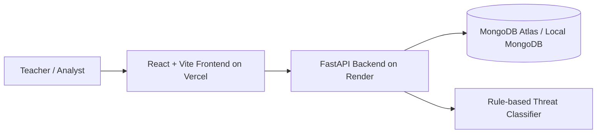

# ThreatLens — Cyber Threat Intelligence Platform

ThreatLens is a full-stack cyber threat intelligence dashboard built with React, FastAPI, and MongoDB. It combines threat intelligence search, analytics, classification, live MongoDB reporting, and the course-based MongoDB performance experiments required for Lab 7.1 and Lab 7.2.

Live app: https://threatlens-demo.vercel.app
GitHub: https://github.com/jayansh1208/threatlens-cyber-threat-intelligence

## Technology stack

- Frontend: React + Vite + TypeScript + Tailwind CSS
- Backend: FastAPI + PyMongo + Pydantic
- Database: MongoDB (local development + MongoDB Atlas for production)
- Deployment: Vercel for frontend, Render for backend

## Architecture diagram



## Features

- Executive SOC dashboard with metrics and trends
- Threat intelligence search, filtering, pagination, and detail pages
- Real-time MongoDB-backed analytics and cache inspection
- Rule-based classification for malware, ransomware, phishing, and breach activity
- Source ingestion and management workflow
- Lab 7.1 production schema analysis and Lab 7.2 working-set analysis
- Clear separation between local development and production settings

## Local development setup

### 1) Backend

```bash
cd ThreatLens/backend
python -m venv .venv
source .venv/bin/activate  # Linux/macOS
# or .venv\Scripts\Activate.ps1  # Windows PowerShell
pip install -r requirements.txt
cp .env.example .env
python -m uvicorn app.main:app --host 0.0.0.0 --port 8000 --reload
```

### 2) Frontend

```bash
cd ThreatLens/frontend
npm install
cp .env.example .env
npm run dev -- --host 0.0.0.0 --port 5173
```

### 3) MongoDB

- Local development: `mongodb://localhost:27017`
- Database name: `threatlens`
- Connect with:

```bash
mongosh mongodb://localhost:27017
```

## Production deployment

### Frontend on Vercel

1. Import the repository into Vercel.
2. Set the project root to `ThreatLens/frontend`.
3. Add environment variable:
   - `VITE_API_URL=https://<your-render-backend>.onrender.com`
4. Deploy.

### Backend on Render

1. Create a new Web Service in Render.
2. Root directory: `ThreatLens/backend`
3. Build command: `pip install -r requirements.txt`
4. Start command: `uvicorn app.main --host 0.0.0.0 --port $PORT`
5. Add environment variables:
   - `MONGO_URI=mongodb+srv://<user>:<password>@<cluster>.mongodb.net/<dbname>?retryWrites=true&w=majority`
   - `DATABASE_NAME=threatlens`
   - `FRONTEND_ORIGINS=https://<your-vercel-app>.vercel.app`

### MongoDB Atlas

1. Create a free or shared Atlas cluster.
2. Create a database user with a strong password.
3. Allow network access from Render and your local machine.
4. Connect using the Atlas connection string.
5. Keep the URL in environment variables only. Never commit secrets.

## API documentation

Once the backend is running locally:

- http://localhost:8000/docs
- http://localhost:8000/redoc

## Lab experiments

### Lab 7.1: Production schema analysis

```bash
cd ThreatLens/labs
python lab_01_production_schema.py
```

### Lab 7.2: Working set analysis

```bash
cd ThreatLens/labs
python lab_02_working_set_analysis.py
```

## Data and sample records

The application seeds demo sample reports when the target database is empty. These are clearly marked as synthetic demonstration data and are intended for testing and classroom use.

## Screenshots

Add screenshots here after deployment or local capture, for example:

- Dashboard view
- Threat list view
- Classification workflow
- Database analytics panel

## GitHub Actions

The repository includes a basic CI workflow that installs frontend and backend dependencies and runs the backend test suite.

## Notes

- The local MongoDB setup remains available for development.
- The production setup reads credentials from environment variables only.
- No `.env`, `.venv`, or local database files are committed to Git.

## License

This project is intended for educational and demonstration purposes.
